
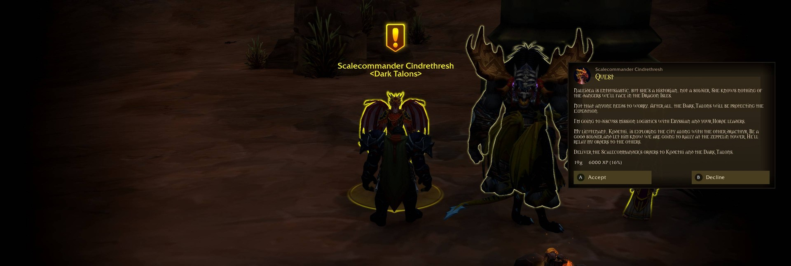

<h1 align="center">Ubermoc UI</h1>
<h3 align="center">Play World of Warcraft without ever touching a mouse or keyboard.</h3>

The whole point of this addon is <strong>immersion</strong>. You sit back with a controller and play, from the first login to the last raid, and never reach for anything else. Every window, menu, vendor, quest and bag can be reached with the controller alone.

It started as a layout built around the <strong>Steam Controller</strong>, but it is made to work with <strong>all controllers</strong>: Xbox, PlayStation, Switch and Steam. Button names and icons follow the controller you use. It is also made to work seamlessly with the <strong>Steam Deck</strong>.

<h2>About me</h2>

I have played World of Warcraft with a controller for 15 years. I know where the rough edges are, and this addon is the result of fixing them one by one.

<h2>No keyboard needed for typing either</h2>

Typing is the one thing a controller can't do well, so I made a companion for it. <strong>Ubermoc Speech</strong> is a voice to text plugin for Decky, so you can talk instead of typing chat messages.

GitHub: <a href="https://github.com/ubermoc/Ubermoc-Speech">Ubermoc Speech</a>

Together, Ubermoc UI and Ubermoc Speech mean you will not need a mouse or keyboard at all.

<h2>Works together</h2>

Three projects made to be used together, so you can play World of Warcraft from the couch with only a controller:

<ul>
<li><strong>Ubermoc UI</strong> (this addon): it makes the game playable without a mouse or keyboard.</li>
<li><strong><a href="https://github.com/ubermoc/Ubermoc-Speech">Ubermoc Speech</a></strong>: a Decky plugin for typing. Hold a button, speak, and your words are typed into chat or anything else with focus.</li>
<li><strong><a href="https://github.com/ubermoc/Ubermoc-Warcraft-Mod-Updater">Ubermoc Warcraft Mod Updater</a></strong>: a Decky plugin that installs Ubermoc UI the first time you open Midnight or Forever, and keeps it (and your other GitHub addons) updated from Gaming Mode.</li>
</ul>

Together: the Updater keeps the addon current, Ubermoc UI lets you play, and Ubermoc Speech does the typing.

<h2>Features</h2>

<h3>Controller layouts</h3>

Four action bar layers per controller, using shared modifier buttons. Start opens the game menu, Select opens the map. On a Steam Controller the back buttons give you interact and jump. Every button's job is shown on the Buttons page, and you can test your buttons and rebuild the binds with one press.

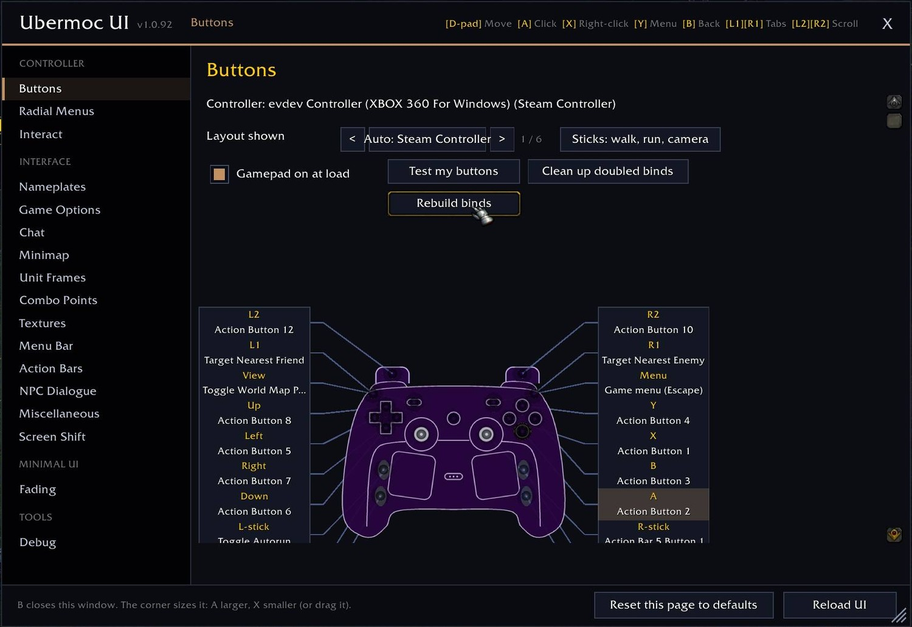 <em>The Buttons page: pick your controller, see what every button does, rebuild the binds.</em>

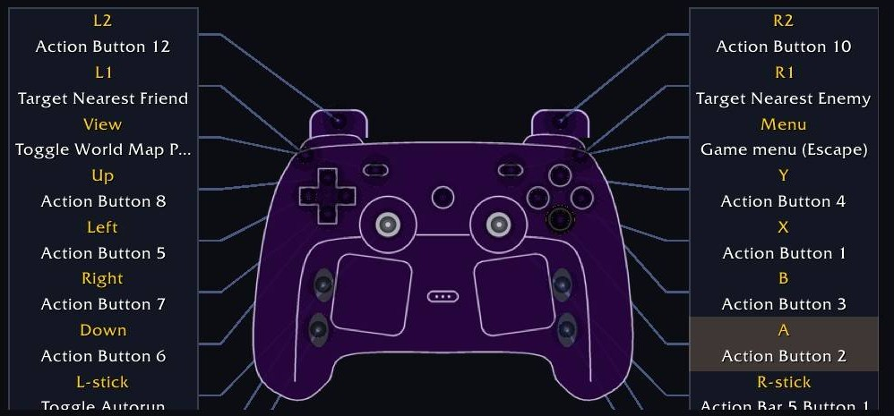 <em>Every button labelled, so you always know what it does.</em>

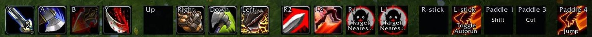 <em>The action bar is labelled with your controller's buttons, not keyboard keys.</em>

<h3>A pointer for every window</h3>

Move between buttons with the D-pad, <strong>A</strong> to click, <strong>X</strong> to right-click, <strong>B</strong> to go back, <strong>Y</strong> for the item menu. It works in vendors, mail, the bank, bags, the spellbook, transmog, the game menu, loot and more, and it jumps straight onto pop-up questions so you never need a mouse to answer them. In bags and the game's menu panels it moves the game's own cursor, the bumpers switch tabs (in the spell window L1 is the Spellbook and R1 is Talents, with a hint under the window), and everything closes by itself when a fight starts. On the character screen, Y over an equipped item opens its menu: swap it from the equipment flyout, open sockets, or apply anything in your bags that is used on equipment (sharpening stones, oils, armor kits, enchant scrolls), with A to accept and B to decline the game's confirmation.

<table align="center">
<tr>
<td align="center" valign="top">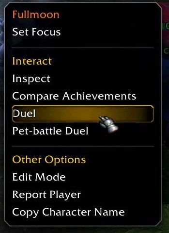 <em>Right-click menus, by controller.</em></td>
<td align="center" valign="top">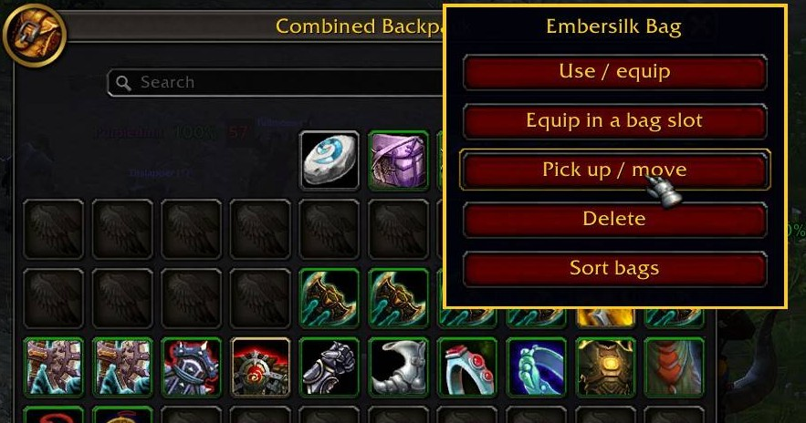 <em>Bags: use, equip, pick up, delete and sort.</em></td>
</tr>
</table>

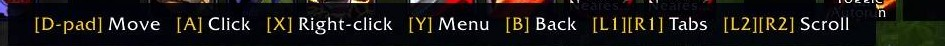 <em>The controls are always shown along the bottom of the screen.</em>

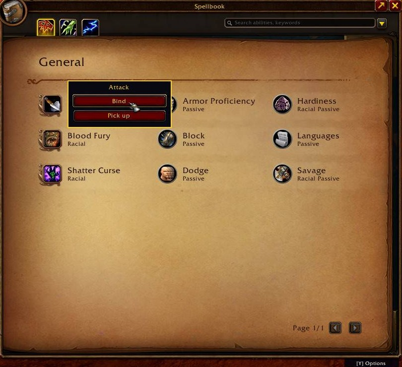 <em>Pick up a spell or bind it to a controller button right from the spellbook.</em>

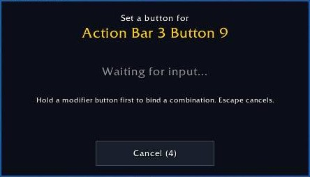 <em>Press the button you want, and it is bound.</em>

<h3>NPC dialogue</h3>

One clean window for gossip, quests and rewards. Choose with the D-pad, compare rewards, and a small gold coin marks the reward that sells for the most. Pick the light or dark parchment, and the colours that suit you.

<table align="center">
<tr>
<td align="center" valign="top">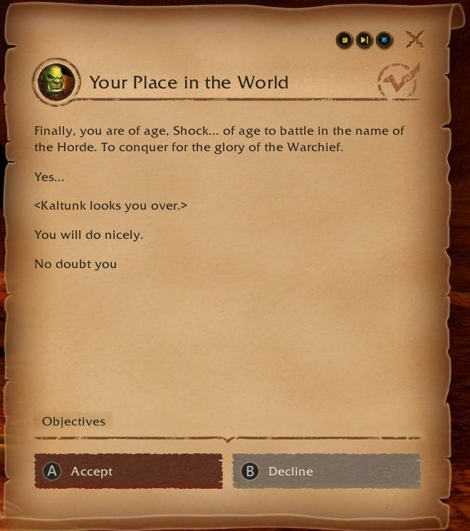 <em>Light parchment.</em></td>
<td align="center" valign="top">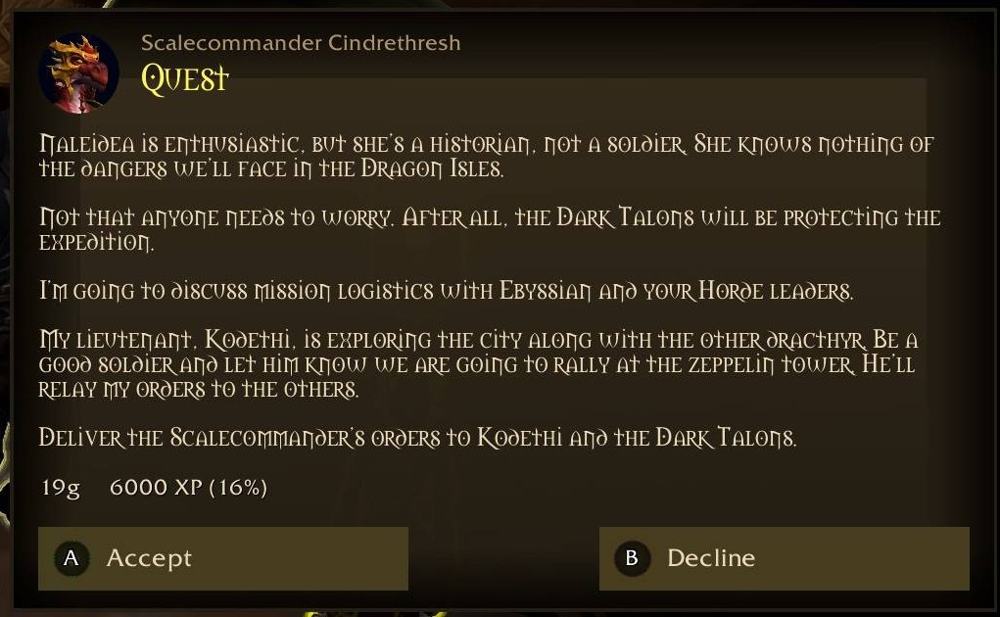 <em>Dark parchment, with the cinematic camera.</em></td>
</tr>
</table>

<h3>Cinematic camera</h3>

When an NPC talks to you the camera eases in, the interface steps back and the black bars come in. Everything goes back when the talk ends or a fight starts.

<h3>Round unit frames</h3>

Player, pet, party, raid, target, focus and more. Choose the Halo (round) style, the Floating style, or the game's own, and set the size, position, text, cast bar and auras for each frame. Floating frames show the unit's level on the portrait, a rogue's combo points as a number on the portrait (or as dots), an estimate of Eviscerate or Ferocious Bite damage on an enemy's health bar, and a row of small buttons above your own portrait (or above the game's own player frame) for Stealth, Vanish and your class's forms and stances, which you can move and resize.

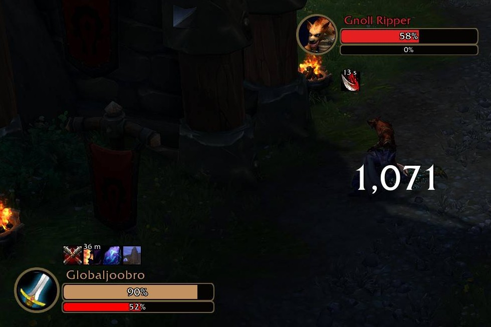 <em>Floating frames in a fight.</em>

<table align="center">
<tr>
<td align="center" valign="top">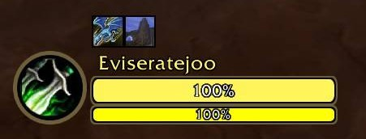 <em>A floating frame, with the class icon.</em></td>
<td align="center" valign="top">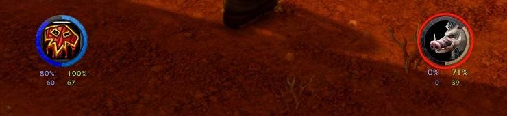 <em>Round portraits for you and your target.</em></td>
</tr>
</table>

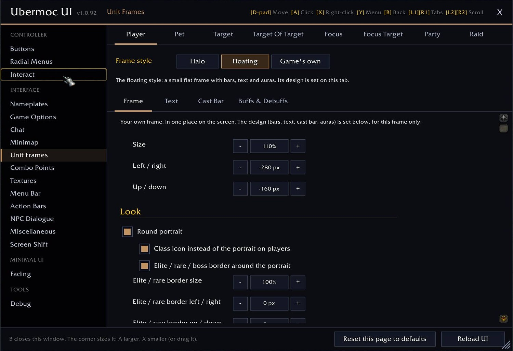 <em>Every frame has its own tab.</em>

<h3>Textures and borders</h3>

Every texture and border in one place, with a live preview: fine grain, brushed metal, carbon fibre, leather, cracked stone, canvas, diamond mesh, dots, scan lines and stripes.

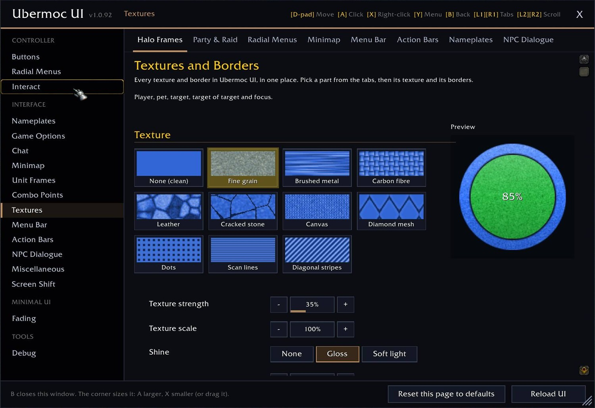 <em>Pick a part from the tabs, then its texture and borders.</em>

<h3>Nameplates</h3>

Clean nameplates for enemies and friends, with a preview and a name-only mode.

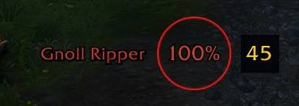 <em>The target's nameplate.</em>

<h3>Radial menus</h3>

Menu, bag and utility wheels that you open and pick from with the controller.

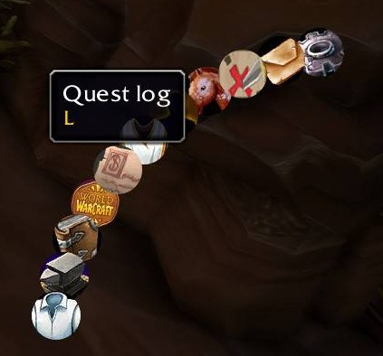 <em>The menu ring, with each entry named.</em>

<h3>A minimal interface</h3>

Parts of the interface fade out of the way until you need them. Choose what fades, and when: in combat, at full health, while moving, mounted, in a group and more. The minimap and quest tracker are restyled to match.

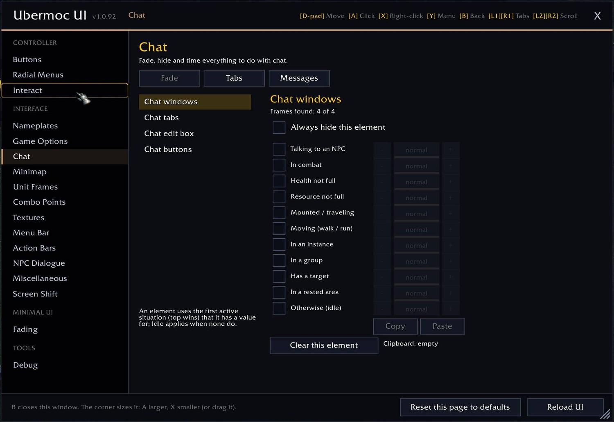 <em>Set when each part fades, here for chat.</em>

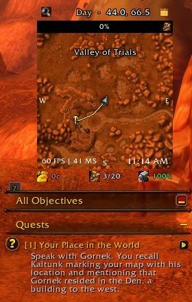 <em>The minimap and quest tracker.</em>

<h3>Aiming ground spells</h3>

Hold a button to aim spells like Heroic Leap or Blizzard, release to cast, with an optional mark in the middle of the screen.

<h2>Install</h2>

On the Steam Deck or any Steam machine, the <a href="https://github.com/ubermoc/Ubermoc-Warcraft-Mod-Updater">Ubermoc Warcraft Mod Updater</a> plugin offers to install this addon the first time you open Midnight or Forever, and keeps it updated.

By hand: download <code>UbermocUI-&lt;version&gt;.zip</code> from the <a href="https://github.com/ubermoc/Ubermoc-UI/releases/latest">latest release</a> (or from the <a href="https://www.curseforge.com/wow/addons/ubermoc-ui">CurseForge page</a>) and extract the <code>UbermocUI</code> folder into <code>World of Warcraft/_retail_/Interface/AddOns</code> (Midnight) or <code>_forever_/Interface/AddOns</code> (Forever).

<h2>Getting started</h2>
<ol>
<li>Install the addon and log in. Open the settings from the game's Options, under AddOns, then Ubermoc UI.</li>
<li>Choose your controller on the Controller page and rebuild the binds.</li>
<li><strong>Steam Controller:</strong> in Steam's controller settings for WoW, set R4 = Left Shift, R5 = Left Ctrl, L4 = F6 and L5 = Space, and start WoW from Steam.</li>
</ol>

<h2>Feedback</h2>

Found a bug or have an idea? Open an issue on the <a href="https://github.com/ubermoc/Ubermoc-UI/issues">Issues tab</a>, or leave a comment on the <a href="https://www.curseforge.com/wow/addons/ubermoc-ui">CurseForge page</a>.

<h2>In this repository</h2>
<ul>
<li><code>UbermocUI/</code> - the addon source</li>
<li><code>CHANGELOG.txt</code> - what changed in each version</li>
<li><code>images/</code> - the screenshots on this page</li>
<li><code>CURSEFORGE-description.html</code> - the text of the CurseForge page</li>
</ul>

<h2>Support the project</h2>

Ubermoc UI is free. If you'd like to say thanks, donations are optional and always appreciated:

<ul>
<li><a href="https://github.com/sponsors/ubermoc">GitHub Sponsors</a></li>
<li><a href="https://ko-fi.com/ubermoc">Ko-fi</a></li>
<li><a href="https://buymeacoffee.com/Ubermoc">Buy Me a Coffee</a></li>
</ul>

Made by Marcos (<a href="https://github.com/ubermoc">Ubermoc</a>).

